# houmon-report-ai
在宅訪問の会話から、医師・ケアマネ向け報告書を下書きする薬剤師向けツール（Built with Claude: Japan 2026）

> 在宅レポAI（仮）。ハッカソン「Built with Claude: Japan 2026」テーマ1「あなたにしかない深さを」への提出作品です。
> **このリポジトリのデータは全て架空です。実在の患者データは使っていません。**

## 何を・誰のために・なぜ

- **何を**: 在宅訪問中の薬剤師と患者の会話（文字起こしテキスト）から、「居宅療養管理指導報告書」の各欄（選択式の欄・備考・SOAP）を下書きする Web アプリ。医師向け・ケアマネ向けは同じ書式で、宛先だけ切り替える。
- **患者リスト**（11/4 追加）: 基本情報（氏名・カナ・生年月日・住所・家族・宛名・訪問頻度・調剤形態・処方・定型欄）を患者ごとに端末内へ保存し、次回からはリストから選ぶだけ。氏名・カナ・生年月日（和暦も）で検索、グループ登録、グループ内はあいうえお順か手動の並び替え。**新しい患者**は氏名・カナ・生年月日だけ入れて会話を取り込むと、会話から読み取れた基本情報（訪問頻度・調剤形態・服薬管理者・管理方法・家族の関与）が空欄に自動入力され、「AI の提案」として確認して保存できる。
- **会話の入れ方**: iPhone のボイスメモの文字起こしを貼り付けるか、キーボードの音声入力で入れる。アプリは音声を録音も送信もしない（扱うのは文字だけ）。
- **誰のために**: 在宅訪問をする薬局の薬剤師。訪問先ではスマホ、薬局ではパソコンで使う。
- **なぜ**: 報告書は 1 枚の作成〜送信に約 15 分かかり、訪問のたびに積み上がる。これを数分にして、薬剤師の時間を患者さんと向き合う仕事に戻す。ただし AI は**下書きまで**。確認・修正・確定は必ず薬剤師が行い、医療上の判断や助言はしない。

## 画面で見る使い方（すべて架空データ）

iPhone 13 相当の幅で撮った実際の画面です。登場する患者・医療機関・事業所は架空（`fixtures/`）。原寸は `docs/screenshots/`。

| ① 患者を選ぶ | ② 会話を貼ってマスク | ③ 下書きを確認 | ④ 送り方を選んで出力 |
|---|---|---|---|
| 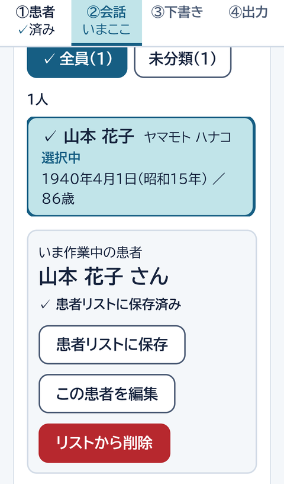 | 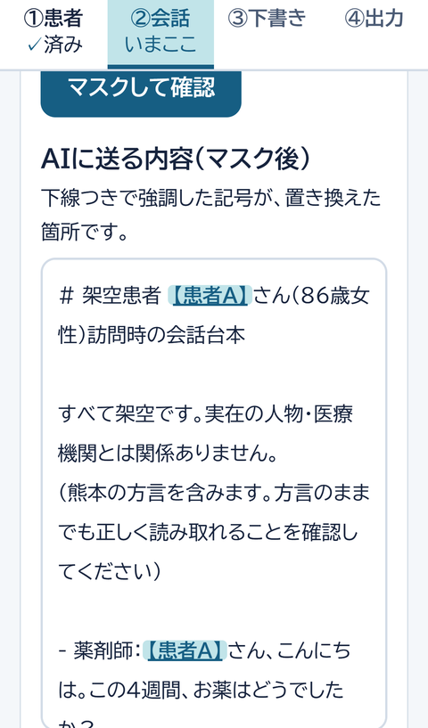 | 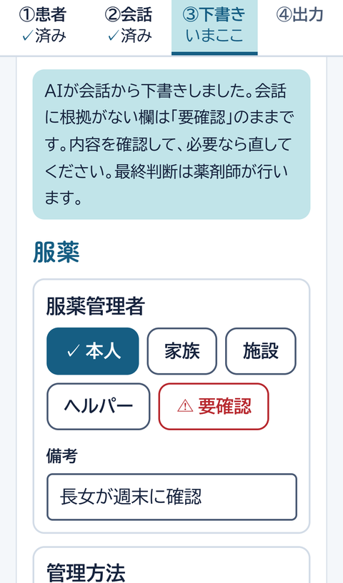 | 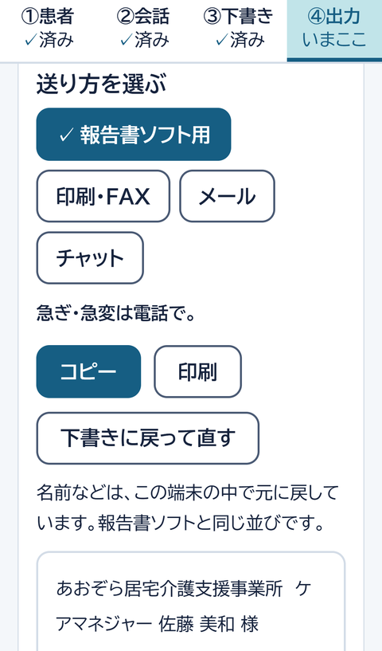 |
| 患者リストから選ぶと基本情報が入る。初めての人は「＋ 新しい患者」。 | 氏名は端末の中で【患者A】に置き換え、対応表は画面の中だけ。AI には送らない。 | 報告書ソフトと同じ並びの選択式。会話に根拠がない欄は「要確認」のまま。 | 報告書ソフト用／印刷・FAX／メール／チャットの 4 つ。どれも端末の中で名前を戻す。 |

| 推測しない | 本人の言葉をそのまま | 連絡事項は宛先で変わる | 確定の前に要確認を数える |
|---|---|---|---|
| 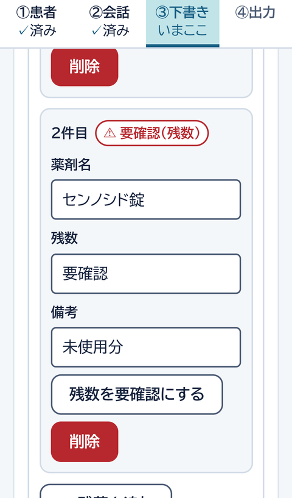 | 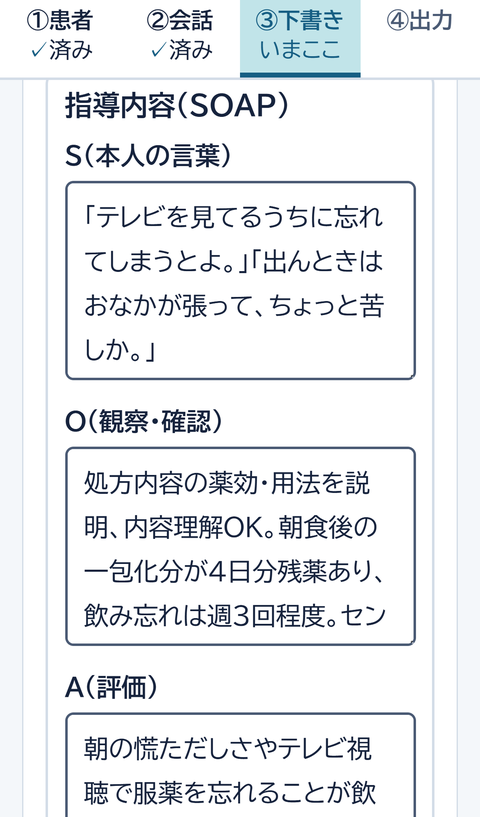 | 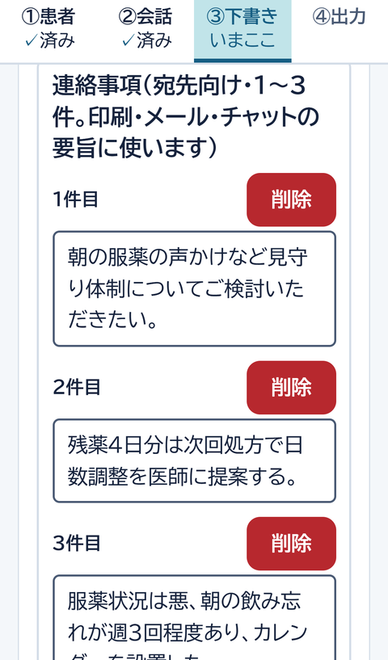 | 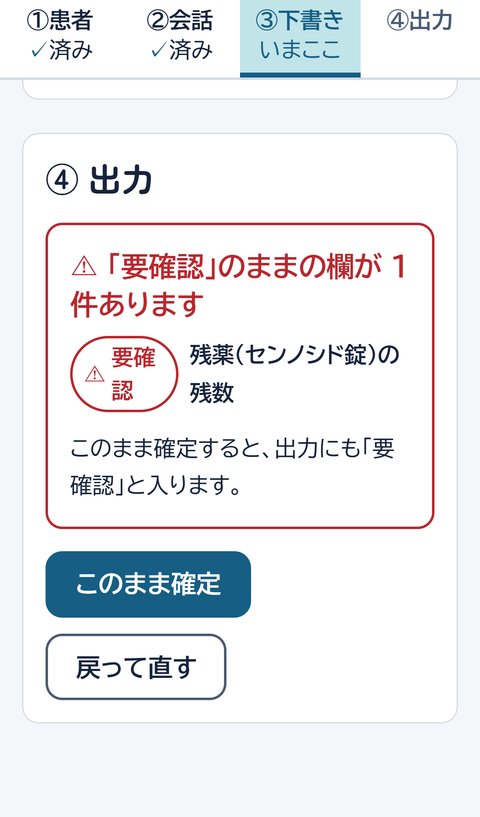 |
| 会話に残数が出てこないセンノシド錠は「要確認（残数）」。空欄を推測で埋めない。 | S は本人の言葉の引用。各欄に「根拠を見る」で会話の該当箇所が付く。 | ケアマネ宛はお願いと医師に提案した事実、医師宛は処方提案が 1 件目（下の画像）。 | 要確認が残っていれば件数と欄を示してから確定。確定も薬剤師が押す。 |

| 印刷・FAX のプレビュー | チャット用（200 字以内） | メール用 | 新しい患者は会話から基本情報 |
|---|---|---|---|
| 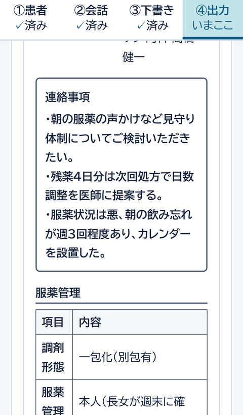 | 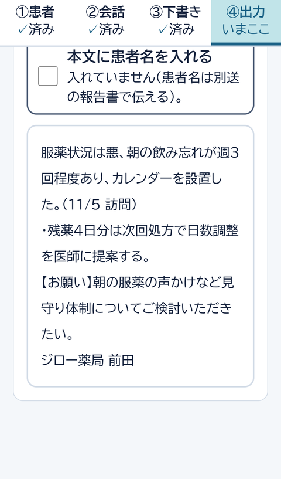 | 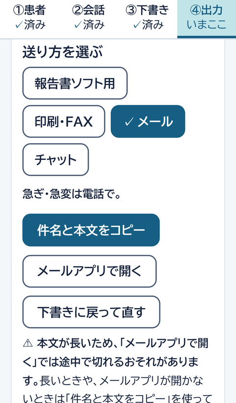 | 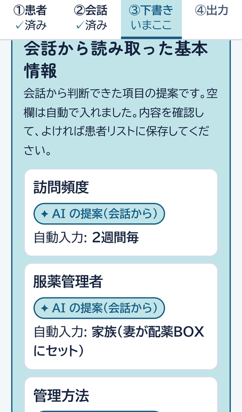 |
| A4 1 枚（処方内容は別紙）。連絡事項を枠で別立て。「急ぎ・急変は電話で。」 | 1 行目が要点、【お願い】、署名。既定で患者名を入れない。 | 件名・本文をコピーするか、メールアプリで開く。長い本文は注意が出る。 | 氏名などの基本だけで会話を取り込むと、訪問頻度・服薬管理者などが提案として入る。根拠のない項目は提案に含めない。 |

医師宛の連絡事項（1 件目が処方の提案になる）と、印刷・FAX 用の A4:

| 医師宛の連絡事項 | 印刷・FAX 用の A4（本紙＋別紙） |
|---|---|
| 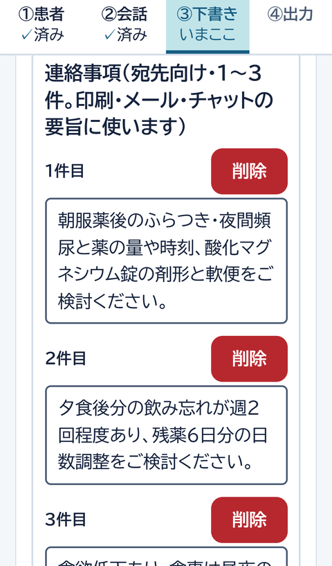 | 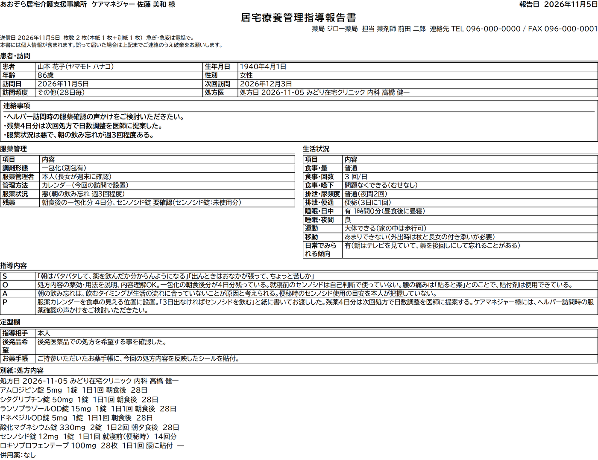 |

パソコンでも同じ画面（薬局では PC、訪問先では iPhone）:

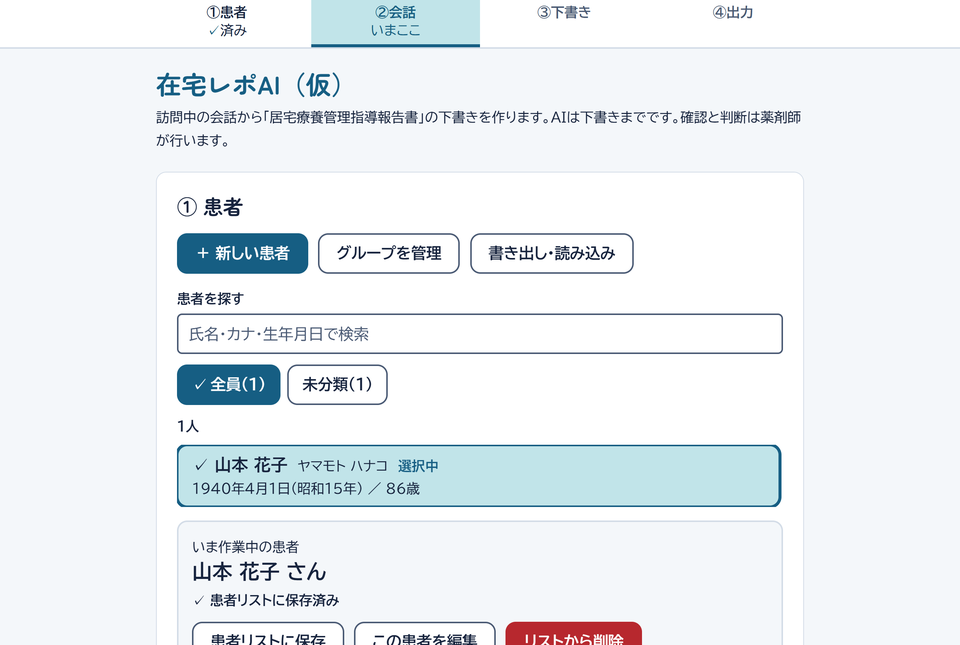

画面の撮り方は `scripts/screenshots.mjs`（Playwright で架空サンプルを流し、iPhone 13 相当の幅で撮る。下書きの API を 2 回呼ぶ。Playwright は devDependencies に入れていないので、使うときだけ `npm i -D playwright@1.61 && npx playwright install chromium`）。

## 構成

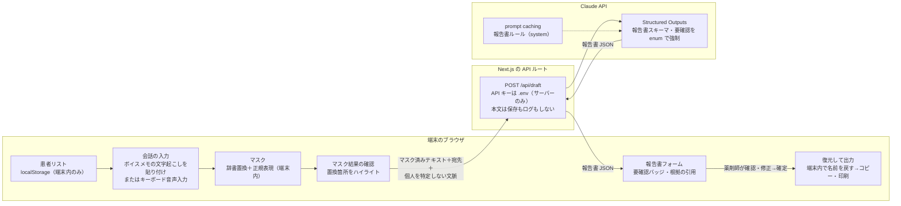

図が描画されない環境向けの手順（上の図と同じ内容）:

1. 患者リストから患者を選ぶ（氏名などは端末の localStorage にだけある）。
2. 会話の文字起こしを貼り付ける（ボイスメモの文字起こし、またはキーボード音声入力）。
3. 端末内でマスク（辞書置換＋正規表現）。氏名・住所などを記号に置き換える。
4. 置換箇所をハイライトで確認する。
5. 「下書きを作る」: マスク済みテキスト＋宛先＋個人を特定しない文脈だけを `POST /api/draft` へ送る（API キーは `.env`、本文は保存もログもしない）。
6. サーバーが Claude API を呼ぶ: system = 報告書ルール（prompt caching の対象）、出力は Structured Outputs の報告書スキーマ。
7. 返った報告書 JSON を、報告書ソフトと同じ並びのフォームに表示する（「要確認」バッジ、根拠の引用。原文に無い引用は警告）。
8. 薬剤師が確認・修正して確定し、端末内で名前を戻して印刷・コピーする。

## 個人情報の境界

- 氏名・住所・生年月日などの**置き換え（マスク）と確定後の復元は、すべてブラウザ内**で行う。元の名前と対応表は端末の localStorage に置き、外へ出さない。
- サーバーと Claude API に送るのは、**マスク済みの会話テキスト、宛先の種別、個人を特定しない基本情報の文脈（訪問頻度・調剤形態・家族の続柄・処方内容。これも同じ辞書でマスク済み）だけ**。宛名・患者名・処方医名・医療機関名は送らない。サーバーは状態を持たず（DB なし）、会話本文を**保存もログ出力もしない**。
- マスク漏れに備え、送信前に置換箇所の確認画面を挟む。辞書に無い名前らしい語（「○○さん」）は警告になり、その場で「家族として登録」「その他の語として登録」すると記号に置き換わる。警告が残ったままでは、人名でないことを確認するチェックを入れないと送れない。送る内容に辞書の語が残っていれば送信を止める。患者氏名が未登録なら下書きボタンは押せない。
- 患者リスト（実名・生年月日・住所・家族の実名・宛名）も端末内の localStorage だけにあり、サーバーにも API にも送らない。AI が会話から提案する「家族の関与」に氏名らしき語が混ざっていたら、自動入力しない（続柄だけを記録する）。
- 端末ごとに別のリストになるため、**書き出し・読み込み**（JSON ファイル）で iPhone と PC の間を移す。書き出しは押したときだけ、実名を含む旨を確認してから。読み込みは「追加・更新」（氏名＋生年月日が同じ人は同じ患者として新しい方を採用、グループは名前で突き合わせ）か「置き換え」（確認あり）で、適用前に内訳を表示する。サーバーは介さない。ファイルは自分の端末どうし（AirDrop・USB）で移し、移し終えたら削除する。暗号化は HTTPS 対応後の候補。
- **受け渡しコード（任意機能・既定オフ）**: 同じ Wi-Fi の薬局の PC と患者リストを受け渡す機能だけは、例外としてサーバーを介する。実名・生年月日・住所を含む患者リストを端末で暗号化し、このアプリを動かしているサーバーのメモリに **10 分だけ**預ける（1 回取り出すと消える・ディスクには書かない・AI には送らない）。ただし**復号に使う 6 桁のコードもサーバーに送られるため、サーバーを動かす PC では中身を読める**。`HOUMON_SYNC=on` と明示したときだけ有効（`.env.example` 参照）。インターネットに公開する環境（Vercel など）では on にしない。コードの総当たりは、IP ごと・全体の失敗上限で止める。取り出しは `POST /api/sync/take`（コードを URL に載せない）。2026-11-06 の決定で、ハッカソン提出版では使わない（オフのまま。画面にはオフの旨が出る）。扱いは CLAUDE.md と docs/PLAN.md §12 に記載。
- 実運用で医療情報を扱う際の取り扱い基準の確認は、ハッカソン提出後の課題。

## Claude の使い分け

目的ごとに機能を選んでいる。

| 目的 | 使うもの | 理由 |
|---|---|---|
| 報告書の全欄を一度に下書きする | **Claude API の Structured Outputs** | 選択式の欄は enum に **「要確認」** を含め、会話に根拠が無い欄を推測で埋めることをスキーマで禁止する。形が保証されるので、そのままフォームに描ける |
| 毎回同じルールを送るコストを下げる | **prompt caching** | 報告書ルール（システムプロンプト）をキャッシュ対象にして、連続して作るときの入力コストと待ち時間を減らす |
| 報告書のルールを「人・AI・アプリ」で共有する | **Claude Code の Skills**（`houmon-report-rules`） | 正本は `prompts/report-rules.md` の 1 か所。アプリのシステムプロンプトはここから生成し、Claude Code はスキル経由で同じファイルを読む |
| 評価結果を読み解く | **Skills**（`/eval-report`）+ **サブエージェント**（`report-qa`） | 見本との差分表から、落ちた欄ごとに根拠の発話と直すルール文を提案する（提案のみで、勝手に書き換えない） |
| 個人情報の二重チェック | **サブエージェント**（`pii-auditor`、`/pii-check`） | 架空宣言の有無、実在しそうな氏名・住所・電話・医療機関名、画像の混入を、独立したコンテキストで監査する |
| キー・実データ・`.env` のコミット防止 | **フック**（`.claude/hooks/`、`.githooks/pre-commit`・`pre-push`） | 人の注意に頼らず、コミット前に機械で止める（下記） |
| 設計・実装・レビューを並列で回す | **Claude Code の Workflow（並行エージェント）＋独立レビュー** | 機能ごとに実装担当を分け、個人情報の境界（端末の外に出る経路）は毎回別のレビューで確かめる。11/2 の最初の実装は 33 エージェントの並行実装で、続くレビューで 16 件を修正した（`docs/PLAN.md` §8） |
| 速さと精度の両立 | **`effort`（adaptive thinking）の比較** | 同じ架空台本で Opus 5.5 の medium と low、Sonnet 5.5 を比べた。選択式はどれも 13/13 で、所要は Opus 5.5 medium が約 19〜20 秒、low が約 10 秒（出力 2,206 → 1,240 トークン）、Sonnet 5.5 medium が約 7〜8 秒。精度を落とさず半分になった Opus 5.5 low を既定にした（各条件 1 回の測定。`docs/PLAN.md` §4-1、`eval-results/history.md`） |
| 外部サービス連携 | **MCP は使わない** | 現時点では連携先（カレンダー・DB・チケット等）が無く、評価や監査はスクリプトとサブエージェントで足りる。目的に合わないものを無理に使わない判断。報告書ソフトへの転記を自動化する段階で、転記先が API を持てば MCP サーバー化する価値がある（次の一手） |

### フックが守っているもの

- `.claude/settings.json` の `PreToolUse`（matcher は `Bash|PowerShell`。この PC の主シェルは PowerShell なので両方を見る。Claude Code が `git commit` / `git push` を実行しようとしたとき）→ `guard-commit.mjs`
  - **commit**: `.env` 系ファイルのステージ、`sk-ant-` 形式の API キーや値入りの `ANTHROPIC_API_KEY=` の追加、先頭 10 行に「架空」宣言が無い `fixtures/` ファイルをブロック。電話番号・郵便番号らしき文字列は警告のみ
  - **push**: `.env` 系の追跡、および push する履歴全体（過去のコミットを含む）に入った API キー形式と、過去に追加された `.env` 系ファイルをブロック。後のコミットで消したキーも履歴に残っていれば止める。限界: 一度履歴に入ったものは、履歴を書き換えて除去するまで止まり続ける。正規表現による検査なので、分割・エンコードされたキーは見つけられない
  - 違反は「どのファイルの何行目に何があったか」を日本語で表示する（秘密の値は先頭 6 文字 + … に丸める）
- `PreToolUse`（`Edit` / `Write` / `Read` / `Bash` / `PowerShell`）→ `guard-env.mjs`: Claude が `.env` / `.env.*`（`.env.example` は除く）を読む・編集するのをブロック。`cat .env`、`Get-Content .env`、リダイレクト、`node -e` などコマンド中の `.env` 参照も止める（`git rm --cached` / `ls-files` / `check-ignore` / `status` だけは許可）。キーが会話記録に残るのを防ぐ。API キーは人が手で書く。判定は `guard-commit.mjs` の `.env` 判定と同じ。変数で文字列を組み立てるなど、正規表現をすり抜ける書き方までは防げない
- `.claude/settings.json` の `permissions.deny`: `Read(.env)` / `Read(.env.local)` / `Read(.env.*.local)`。Read ツールの読み取りを権限の層でも止める（フックとの二重化。`.env.example` は読める）
- `.githooks/pre-commit`: 同じ `guard-commit.mjs` を `git commit` 時に実行。Claude Code 以外（手でのコミット）も守る。`git add -A && git commit` のように 1 つのコマンドで追加とコミットを続ける場合、Claude Code のフックは追加前に検査するため、この pre-commit が最終防衛線になる
- `.githooks/pre-push`: `guard-commit.mjs --pre-push` を `git push` 時に実行。Claude Code のフックを通らない push（手での push、フックが効かない経路）も、push 前に履歴全体を検査して止める

## 試行錯誤の跡（判断の記録）

- **「要確認」を enum で強制した**: 会話に根拠が無い欄を推測で埋めると、確認し忘れたまま報告書に載る。プロンプトのお願いに頼らず、選択式の欄の enum に「要確認」を含めて、埋めないという選択をスキーマで用意した（`src/lib/report/schema.ts`、`docs/PLAN.md` §4-2）。
- **聞き返しは「内容理解要確認」にする**: O は毎回「処方内容の薬効・用法を説明、内容理解OK。」から始めるが、聞き返し・混乱・説明と食い違う発言があれば「内容理解要確認」に変えるルールを足し、聞き返しだけを入れた専用の架空台本 `fixtures/yamamoto-hanako-kikikaeshi` で確かめた（`prompts/report-rules.md`、`eval-results/history.md` の 11/2 16:37（ルール改訂 2）と 16:38（当時の台本名は `fixture-rikai`）、11/4 09:44 の `yamamoto-hanako-kikikaeshi` の行）。
- **備考は「1 事実・重複なし」にした**: 選択式は 13 項目中 11 項目の一致から 13/13 になっても、備考の文は見本とずれが残っていた。備考は 1 事実だけ、他の欄と重複させない、と文体のルールを直したら、見本とずれていた備考がすべて一致した（`prompts/report-rules.md`、`eval-results/history.md` のルール改訂 1〜3）。
- **既定を Opus 5.5 / effort low にした**: medium と同じ 13/13 のまま、所要が約 19 秒から約 10 秒になった。Sonnet 5.5 は `HOUMON_MODEL` で選べる高速な代替にとどめた（`docs/PLAN.md` §4-1）。
- **新患の自動入力に人名らしき語は入れない**: 会話から提案する「家族の関与」に氏名らしき語が混ざっていたら自動入力も反映もせず、続柄だけを手で入れてもらう（`src/lib/ui/suggestions.ts`）。
- **HTTPS は OpenSSL の自前 CA にし、思い込みを訂正した**: スマホでマイクや「クリップボードから貼り付け」など安全なコンテキストが要る機能を使うには https が要るので、mkcert の取得が要らない OpenSSL で開発用 CA を作った（`scripts/make-dev-cert.mjs`）。「鍵マークが出れば完了」と案内したのは誤りで、iOS 26・27 の Safari は鍵マークを出さない。Apple のガイドに合わせ、警告が出ないことと「接続セキュリティの詳細」を確認の基準にした（`docs/PLAN.md` §4-6）。
- **実機診断 `/diag` で、アプリ内の音声認識・録音を作らない判断をした**: iPhone の Safari（iOS 27）は端末内処理を指定できず（`processLocally` 非対応）、音声が外に出ないことを保証できなかった。代わりにボイスメモの文字起こしの貼り付けとキーボード音声入力に絞った（`src/app/diag/page.tsx`、`docs/PLAN.md` §4-5）。
- **環境変数名の衝突を直した**: effort の設定名 `CLAUDE_EFFORT` が Claude Code の環境変数と衝突したため、`HOUMON_EFFORT` に改名した（`docs/PLAN.md` §8、`src/lib/claude/client.ts`）。

## 出力の形式（④ 送り方を選ぶ）

確定した報告書は、送り方に合わせて 4 つの形に整えて出す（どれも端末の中で作る。サーバーや AI には送らない）。中身の決め方は、医師宛・ケアマネ宛・介護職向けの様式と FAX・メール・チャットの作法を一次情報で調べた [`docs/RESEARCH-report-formats.md`](docs/RESEARCH-report-formats.md) に基づく。

| 形式 | 中身 | 使いどころ |
|---|---|---|
| 報告書ソフト用 | 全欄のプレーンテキスト（従来どおり） | 報告書ソフトに貼る |
| 印刷・FAX 用 | A4 1 枚。上段に送信日・宛先・送信元（薬局名と連絡先）・誤送信時の注意文、患者情報、**連絡事項**（医師宛は処方提案、ケアマネ宛はお願いと医師に提案した事実）、服薬管理と生活状況の表、SOAP、定型欄、処方内容。白黒で読める | 「PDF・印刷」で印刷、または PDF にして FAX・添付 |
| メール用 | 件名と本文。**既定では患者名を入れない**（別送の報告書で伝える）。要旨 2〜3 行＋署名、300 字以内を目安 | 「件名と本文をコピー」か「メールアプリで開く」 |
| チャット用 | 1 行目に要点、事実 1〜2 行、お願い 1 行、署名。**患者名なし**、200 字以内。画面に「急ぎ・急変は電話で」 | 多職種連携の SNS（利用者ごとのグループに書く前提） |

宛先が医療機関なら要点と連絡事項は処方提案（P の最後の依頼文）、ケアマネならお願いになる。「本文に患者名を入れる」はメールとチャットだけの切替で、既定はオフ。

**連絡事項は AI の下書き欄**（`contactNotes`、1〜3 件）。宛先別のルール（医師＝処方提案、ケアマネ＝お願い＋医師に提案した事実＋服薬状況の要約）を `prompts/report-rules.md` に書き、③下書きで薬剤師が直してから、印刷の枠・メールの要旨・チャットの要点に使う。追加後も 3 本の架空台本で選択式 13/13 を維持（`eval-results/history.md` 11/5 20:17）。印刷の見本は `/print-sample/yamamoto-hanako`（ケアマネ宛）と `/print-sample/sasaki-kiyoshi`（医師宛）で、架空データのまま Ctrl+P で A4 の収まりを確認できる（本紙 1 枚＋別紙の処方内容）。

## 失敗したときの表示

下書きの作成に失敗したときは、原因別に見出し・説明・「次にすること」を出す（`src/components/DraftErrorPanel.tsx`、分類は `src/lib/report/draft-errors.ts`）。API キー未設定・無効、権限、モデル名の誤り、**残高不足**は利用者側では直せないので「管理者（社長）に連絡」と、連絡用の詳細（code・種別・モデル・時刻だけ。会話や個人情報は含まない）のコピーを出す。混雑・レート制限は秒読み付きの再試行、通信の失敗は Wi-Fi とサーバーの確認を案内する。オフラインのときは送信前に知らせ、`GET /api/health`（キーの値は返さず、設定の有無とモデル名だけ）でサーバーの準備状態を画面に出す。

## 使い方

```bash
git clone https://github.com/yakunchu/houmon-report-ai.git
cd houmon-report-ai
cp .env.example .env          # .env を開き、ANTHROPIC_API_KEY に自分のキーを手で書く（.env は git 管理外）
npm install
git config core.hooksPath .githooks   # コミット前の安全検査を有効にする（ローカル設定。clone ごとに 1 回）
npm run dev                   # 画面を起動
npm run eval                  # 架空台本で下書きを作り、見本と比べる（API を 1 回呼ぶ。費用が掛かる）
```

- モデルと effort は環境変数で切り替えられる（`.env.example` の `HOUMON_MODEL` / `HOUMON_EFFORT`）。既定は `claude-opus-5-5` / `low`（架空台本 2 本の比較で `medium` と同じ精度のまま約 10 秒。`claude-sonnet-5-5` なら約 7〜8 秒。`docs/PLAN.md` §4-1）。
- **会話の入れ方**: 文字起こしを貼り付ける。iPhone は、ボイスメモで録音 → 「文字起こしを表示」→ コピー → アプリの「クリップボードから貼り付け」。その場で話すならキーボードの音声入力（Apple の案内では日本語は iPhone 上で処理）。アプリは音声を録音も送信もしない。Safari は端末内処理を保証した音声認識（`processLocally`）を提供しないため、アプリ内の音声認識は採用しなかった（実機診断 `/diag`、`docs/PLAN.md` §4-5）。
- **スマホから https で開く（「クリップボードから貼り付け」ボタンが「安全なコンテキスト」を要するため。`/diag` のマイク診断も同じ）**: `npm run cert:dev` で開発用 CA と LAN IP 入りのサーバー証明書を `certificates/`（git 管理外）に作り、`npm run dev:https` で起動する（`https://<PC の IP>:3000`）。OpenSSL（Git for Windows 付属）だけで作るので mkcert のダウンロードは不要。iPhone には CA（`certificates/rootCA.pem`。公開鍵だけ）を入れる: `npm run serve:ca` で PC が `http://<PC の IP>:8788/` に QR と手順を出す → iPhone で QR を読む → プロファイルをインストール → 設定 > 一般 > 情報 > 証明書信頼設定で「houmon-report-ai dev CA」を ON。PC の IP が変わったら `npm run cert:dev -- --force` で作り直す。`rootCA-key.pem` は PC の外に出さない。開けたかの確認は「この接続はプライベートではありません」の警告が出ないこと（iOS 26・27 の Safari はアドレスバーに鍵マークを出さない。Apple のガイドどおり、ページメニュー → 接続セキュリティの詳細で発行者を見る）。`https://<PC の IP>:3000/diag` を開くと、その端末で録音と端末内音声認識が使えるかを確かめられる（患者データは扱わない診断画面。結果はコピーして報告できる）。
- 同じ Wi-Fi のスマホからは `http://<PC の IP>:3000` で開ける。Next.js は `localhost` 以外からの開発アクセスをブロックするため、`next.config.ts` の `allowedDevOrigins` に PC の LAN IP（`192.168.x.x` と `192.168.x.*`）を登録してある。別のネットワークでは書き換える。http では「クリップボードから貼り付け」ボタンが使えない（長押しのペーストと、コピーの予備手段は動く）。HTTPS で開く方法の比較は `docs/PLAN.md` §4-6。
- **処方内容のコピペ**: ①基本情報の「処方内容」に「クリップボードから貼り付け」がある。レセコンや薬歴の画面からコピーした文をそのまま貼ると、1 行 1 剤に整え（タブ・連続空白を正規化、先頭の番号を除く）、医師名・医療機関名らしい行と患者情報らしい行は「外した行」として確認を出す（処方内容は AI に送るので、医師名を混ぜないため。`src/lib/ui/prescription.ts`）。「前回の処方を使う」で患者リストに保存した前回分を戻せる。「薬局の連絡先（TEL・FAX）」は端末の設定で、FAX の送信元とメールの署名に使う（AI には送らない）。
- **iPhone とパソコンの受け渡し（受け渡しコード）**: ①の「書き出し・読み込み」に、同じ Wi-Fi の中で 6 桁のコードで患者リストを渡す方法を追加した。中身は端末の中で暗号化し、アプリを動かしているサーバーのメモリに 10 分だけ預ける（1 回取り出すと消える・ディスクに書かない・AI には送らない）。復号用のコードもサーバーに届くため、サーバーを動かす薬局の PC では中身を読める点に注意。`.env` に `HOUMON_SYNC=on` と書いたときだけ有効（既定はオフ。インターネットに公開する環境では on にしない）。2026-11-06 の決定で提出版ではオフのまま。ファイルでの書き出し・読み込みも残している。
- ルールを変えるときは `prompts/report-rules.md` だけを直し、`npm run gen:prompt` → `npm run eval` で見本との一致を確認する。評価の記録は `eval-results/history.md` に残る。
- デモ動画（3 分以内）の構成案は [`docs/DEMO.md`](docs/DEMO.md)、実装計画は [`docs/PLAN.md`](docs/PLAN.md)。

## 架空データ方針

- 実在の患者データは**絶対に**使わない。開発・テスト・デモはすべて架空データ。
- `fixtures/` の台本・見本・基本情報は全て架空（先頭に「架空」の宣言を置く。フックがこれを強制する）。登場人物・医療機関・事業所は実在しない。
- 見本の文をプロンプトに丸写ししない（評価が意味を失うため）。ルールは一般化して書く。
- `pii-auditor`（`/pii-check`）で、コミット前・公開前に架空データ以外の混入を監査する。

## 評価（合格ライン）

架空患者「山本花子さん（86 歳女性）」の訪問時の会話台本 `fixtures/yamamoto-hanako/transcript.md` から、見本 `expected_report.md`（機械判定用は `expected.json`）と**同じ選択・備考・SOAP** が出ること。

- 選択式の欄: 見本と完全一致を合格とする。台本に根拠が無い項目（例: センノシドの残数）は推測せず「要確認」になるのが正しい挙動。
- 備考・SOAP: 見本と並べて人が判定する。S は本人の言葉の引用で、台本に実在すること。出力にマスク記号以外の氏名が無いこと。
- 台本は熊本の方言を含む。方言のまま正しく読み取れるかも確認する。
- 架空台本は 3 本: `yamamoto-hanako`（ケアマネ宛。社長が作成した見本）、`yamamoto-hanako-kikikaeshi`（説明直後に聞き返しあり → O が「内容理解要確認」になること）、`sasaki-kiyoshi`（医師宛。服薬管理者＝家族、配薬BOX、食事量＝小、嚥下・尿頻度・便通・不眠など別の選択肢が動き、P が「先生には〜をご検討いただきたい」で終わること。見本は開発側の案を社長が確認済み）。`npm run eval -- --fixture=fixtures/sasaki-kiyoshi --recipient=医療機関` で実行。
- `npm run eval` が欄ごとの「見本 / 実際 / 一致」の表を出し、結果を `eval-results/` に記録する。落ちた欄の原因分析は `/eval-report` と `report-qa`。

## 進捗

| 日 | 状況 |
|---|---|
| Day 0（11/2）済 | 計画（`docs/PLAN.md`）、報告書スキーマとルールの正本、架空フィクスチャ、Claude Code 基盤（フック・Skills・サブエージェント）。貼り付け → マスク確認 → 下書き → フォーム → 確定 → 復元 → コピー・印刷の一連の経路が動く。評価は選択式 13/13 一致、S は原文引用、センノシドの残数だけ「要確認」（`eval-results/history.md`） |
| 11/3〜11/4 済 | iPhone（同じ Wi-Fi）から開けるように（`allowedDevOrigins`、http でも動くコピー）。**患者リスト**（検索・グループ・並び替え・新患の自動入力）を追加。評価は通常・新患モードとも選択式 13/13、提案欄は会話どおり（`eval-results/history.md`） |
| 11/4（続き）済 | 患者リストの書き出し・読み込み。備考・SOAP の文体調整（備考は 1 事実、S は 2 件、P に当然のことは書かない → 見本とずれていた備考がすべて一致）。モデル・effort の比較で既定を Opus 5.5 / low に（約 10 秒）。3 本目の架空台本（医師宛）。失敗時の表示を原因別に（残高不足・キー無効は管理者へ連絡＋詳細コピー、混雑は秒読み再試行、オフライン検知、`/api/health` でキー設定の有無） |
| 11/4（夜）済 | iPhone から https で開けるように（自前の開発用 CA）。端末診断 `/diag` で、iOS 27 の Safari は端末内処理の音声認識に非対応と判明 → **アプリ内の音声認識・録音は作らない**（サーバー送信型は使わない方針）。代わりに②会話へ「会話の入れ方」とクリップボード貼り付けボタンを追加（ボイスメモの文字起こし → 貼り付け。キーボード音声入力は日本語が端末上処理） |
| 11/5 済 | 社長の iPhone（https）で、②会話 → マスク → 下書き → ④出力まで通しで動くことを確認。音声入力が英語になる件はキーボードの言語（地球儀で日本語に切替）が原因と判明し、画面の案内はそのまま。README の構成図・判断の記録、`/eval-report` に台本一覧と提出前の最終評価を追加。デモ台本（`docs/DEMO.md`）を撮影用に固定（宛先の違いはサンプル②で見せる、iPhone 収録の手順）。本番ビルドでサンプル①の通し稽古（下書き 16 秒以内、出力で氏名が戻る）。提出前の最終評価を前倒しで実施: 3 本とも選択式 13/13、S の引用 2/2、10.9〜13.1 秒（`eval-results/history.md` 11/5 17:26〜）。個人情報監査（`pii-auditor` 相当）は NG 0・要確認 6（LAN IP の記載、git 管理外の証明書と評価 JSON、架空の事業所名） |
| 11/5（夜）済 | 社長の要望で 3 点を追加。(1) 画面全体を薬局のデザインシステム「ジローブルー」に（BIZ UDPゴシック／Zen Maru Gothic、藍の主色、白藍の色面。機能と文言は変えず、画面案は Claude Design で先に確認）。(2) ④出力に「送り方を選ぶ」（報告書ソフト用／印刷・FAX の A4／メール／チャット。様式と作法の一次情報調査 `docs/RESEARCH-report-formats.md` に基づく）。(3) 処方内容のコピペ貼り付けと「前回の処方」、薬局の連絡先欄、iPhone とパソコンの受け渡しコード（暗号化・10 分・既定オフ）。個人情報レビュー（Opus）で総当たり対策と既定オフを反映 |
| 11/6 | iPhone 実機でデモの通し稽古、提出文の下書きの見直し（予備日） |
| 11/7〜11/8 | デモ動画、提出文、最終評価と監査。提出は 11/8（日）20:00 JST |

計画の詳細は [`docs/PLAN.md`](docs/PLAN.md)、プロジェクトの前提は [`CLAUDE.md`](CLAUDE.md) を参照。

## ライセンス

[`LICENSE`](LICENSE) を参照。
